Verify: [Oracle Agentic AI](https://catalog-education.oracle.com/ords/certview/sharebadge?id=4B825A729AB630E787C326D8DB96C23612EE33B601BC618EE7D66AC867D6440E) · [MongoDB RAG (Credly)](https://www.credly.com/badges/162611ec-693d-4abb-9dcd-aa1a65f4098b/public_url)

